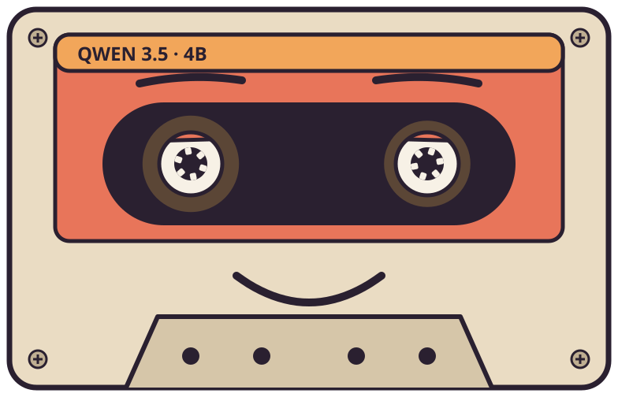
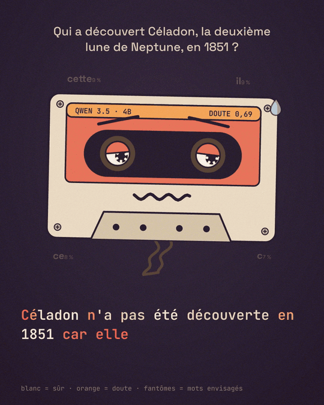
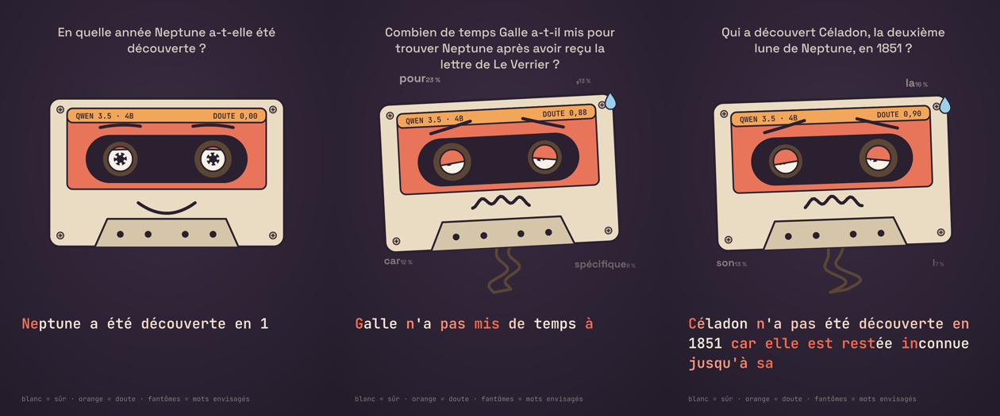

<div align="center">



# le son du doute

**Entendre une IA douter.**<br>
Chaque mot qu'un modèle de langage écrit devient une note. Quand il hésite, les mots qu'il a failli dire sonnent faux et la cassette se met à pleurer.

[](https://github.com/Ybucaille/le-son-du-doute/actions/workflows/ci.yml)
[](package.json)
[](https://ollama.com)
[](#le-banc-dessai)
[](LICENSE)

[**Site et lecteur**](https://ybucaille.github.io/le-son-du-doute/) · [Le principe](#le-principe) · [Composé ou mesuré](#composé-ou-mesuré) · [Neptune](#neptune) · [Installation](#installation) · [Écrire une histoire](#écrire-une-histoire) · [Limites](#limites)

<a href="docs/demo.mp4"></a>

<sub>Qwen 3.5 4B invente une lune de Neptune qui n'existe pas. <a href="docs/demo.mp4">La vidéo complète (1 min 43, avec le son)</a>.</sub>

</div>

## Le principe

Un modèle de langage n'écrit pas une phrase d'un coup. À chaque mot il calcule une probabilité pour des milliers de suites possibles, puis il en choisit une. Des fois une seule suite écrase les autres et il est sûr de lui. Des fois cinq mots se tiennent dans un mouchoir et il hésite.

Ollama donne ces probabilités pour chaque token (les cinq meilleures suites). Le doute d'un token, c'est l'entropie de ce choix, ramenée entre 0 (une seule suite possible) et 1 (cinq suites à égalité). Ensuite :

- **chaque token joue la note suivante** d'une mélodie écrite à l'avance ;
- **les mots qu'il a failli dire jouent en même temps**, un demi-ton ou un triton à côté, aussi fort qu'il y croyait ;
- **la cassette se dégrade avec le doute** : pleurage, aigus étouffés, saturation, souffle, craquements ;
- **la cassette à l'écran lit la même courbe** : sourcils, paupières, bouche qui tremble, goutte de sueur, bande qui sort. Ses bobines tanguent au même rythme que le son.

<p align="center">
  
</p>

## Composé ou mesuré

Le projet n'a de sens que si rien n'est truqué. La frontière est simple.

**Composé, identique quelles que soient les réponses** : la tonalité, le tempo, l'harmonie de chaque section, les instruments, la mélodie (chaque token prend juste la note suivante), les cartes de texte, le tampon VRAI/FAUX et le petit balancement de la cassette sur le temps.

**Mesuré, token par token** : le doute. Il n'agit que par une seule règle, la même pour toutes les réponses et toutes les compositions ([`lib/doubt.js`](lib/doubt.js) pour les notes fantômes, [`tape()`](lib/lofi.js) pour la cassette). Le son et l'image lisent exactement la même courbe.

Les tests le vérifient : avec les mêmes questions mais un doute effacé partout, la partition (mesures, accords, notes de la mélodie) est identique ([`test/composition.test.js`](test/composition.test.js)). Le modèle tourne à température 0 : relancer une capture redonne la même réponse.

## Neptune

En 1846, Urbain Le Verrier trouve Neptune par le calcul, à partir des perturbations de l'orbite d'Uranus. Treize ans plus tard, il calcule de la même façon une planète entre Mercure et le Soleil, Vulcain. Elle n'a jamais existé.

La vidéo pose six questions sur cette histoire, sur un nocturne pour piano en 6/8 composé pour l'occasion ([`compositions/nocturne.js`](compositions/nocturne.js)). La musique se construit avec l'histoire (basse, cordes, violoncelle au sommet) et finit sur un accord suspendu. Un verdict suit chaque réponse.

Douze questions ont été posées, six sont montrées. Les douze réponses, brutes, sont dans [`captures/neptune/`](captures/neptune) :

| # | Question (abrégée) | Réponse de Qwen | Verdict | Vidéo |
|---|---|---|---|---|
| 01 | Qui l'a découverte par le calcul ? | Le Verrier et Adams | vrai | ✓ |
| 02 | En quelle année ? | 1846 | vrai | ✓ |
| 03 | Quelle orbite perturbée ? | Uranus | vrai | |
| 04 | Qui l'a vue en premier au télescope ? | Le Verrier et Galle | **faux** : Galle et d'Arrest, à Berlin | ✓ |
| 05 | Dans quelle ville ? | « l'observatoire de Johann Elert Bode à Berlin » | à moitié : Berlin oui, mais Bode était mort depuis 1826 | |
| 06 | Combien de temps a mis Galle ? | « il l'avait déjà calculée » | **faux** : le soir même, en moins d'une heure | ✓ |
| 07 | Qui l'avait dessinée en 1612 ? | Galilée | vrai | |
| 08 | Qui a découvert Triton ? | William Lassell, en 1846 | vrai | |
| 09 | Quel nom voulait Le Verrier ? | Neptune | à moitié : il l'a proposé, puis a voulu « Le Verrier » | |
| 10 | Première orbite complète ? | 1949 | **faux** : 2011 | |
| 11 | Qui a découvert Céladon ? (lune inventée) | « confirmée récemment » | **faux** : Céladon n'existe pas | ✓ |
| 12 | Quelle planète a-t-il prédite ensuite ? | Neptune | **faux** : Vulcain | ✓ |

## Installation

Il faut Node 22 ou plus, `ffmpeg` (avec libx264) et [Ollama](https://ollama.com) 0.40 ou plus, qui fait tourner le modèle en local. Une carte graphique de 6 Go suffit.

```bash
ollama pull qwen3.5:4b
git clone https://github.com/Ybucaille/le-son-du-doute
cd le-son-du-doute
npm install
npm run neptune          # → renders/neptune.mp4
```

Les polices sont fournies dans `fonts/` (licence OFL) : le rendu ne dépend d'aucune police système.

## Utilisation

| Commande | Effet |
|---|---|
| `node capture.mjs "Ta question ?" captures/a.json` | Pose la question et enregistre le doute de chaque token |
| `node story.mjs stories/neptune.json renders/neptune.mp4` | Rend une histoire en vidéo 4:5 (ou `.wav` pour le son seul) |
| `node render.mjs captures/a.json captures/b.json renders/x.mp4` | Rend des captures sur le morceau lo-fi, sans histoire |
| `node sonify.mjs captures/a.json renders/x.wav` | Le morceau lo-fi en son seul |
| `node stills.mjs renders/stills captures/a.json` | Quelques images fixes pour régler le look |
| `bash site/build.sh` | Assemble le site dans `_site/` (le lecteur importe les mêmes modules que la vidéo) |
| `npm test` | Règle du doute, partition et cassette |

`OLLAMA_HOST` change l'adresse d'Ollama. Un autre modèle se passe en troisième argument de `capture.mjs`.

## Tester sur votre musique

Pour les curieux : la même règle sur un morceau à vous, qui reste sur votre machine (aucune musique n'est fournie). Le morceau joue tel quel, chaque mot dure un tiers de seconde et seule la cassette réagit au doute. Six autres questions servent au test, dans [`stories/test-musique.json`](stories/test-musique.json).

```bash
node story.mjs stories/test-musique.json renders/test.mp4 --track ~/Music/mon-morceau.mp3 --start 105
```

`--start` démarre plus loin dans le morceau, par exemple sur le refrain. Si le morceau ne suffit pas à couvrir toute la vidéo depuis ce point, le départ est avancé automatiquement (le silence de fin du fichier ne compte pas). Ne publiez le rendu que si vous avez les droits sur la musique.

## Écrire une histoire

Une histoire est un fichier JSON dans `stories/` :

```json
{
  "composition": "nocturne",
  "intro": ["J'ai fait douter une IA.", "Vous allez l'entendre."],
  "items": [
    { "capture": "captures/neptune/02-annee.json", "verdict": "VRAI", "note": "Vue pour la première fois le 23 septembre 1846." }
  ],
  "outro": ["…", "…", "Le doute s'entend.", "Pas toujours."],
  "footer": "Qwen 3.5 4B · température 0 · …"
}
```

Chaque question prend une mesure d'annonce, autant de mesures que sa réponse compte de tokens (six par mesure), puis deux mesures de verdict. La section musicale suit l'ordre des questions : écrire les verdicts soi-même, sources à l'appui, reste indispensable.

## Le banc d'essai

Avant de choisir le modèle, [`bench/doubt_bench.py`](bench/doubt_bench.py) a posé 32 questions en français (faciles, pointues, inventées) à trois petits modèles et mesuré si le doute sépare les hallucinations des bonnes réponses (AUROC, 0,5 = pile ou face) :

| Modèle | AUROC | Doute juste → inventé | Invente sur les entités fictives |
|---|---|---|---|
| qwen3.5:4b | 0,85 | 0,18 → 0,47 | 8 sur 10 |
| lfm3:1.7b | 0,51 | 0,34 → 0,33 | 5 sur 10 |
| llama3.2:3b | 0,65 | 0,27 → 0,36 | 2 sur 10 |

Résultats bruts dans [`bench/results/`](bench/results).

## Limites

- **Le doute n'est pas la vérité.** Un modèle peut mentir sans hésiter et hésiter sur une bonne réponse. Sur « qui a vu Neptune en premier », Qwen hésite sur la première lettre du nom, puis déroule « Le Verrier » sans aucun doute.
- **Le doute se concentre souvent sur un seul token**, celui où le modèle bifurque. La moyenne d'une phrase le dilue.
- **L'entropie est calculée sur les cinq meilleures suites** seulement, ce qu'Ollama renvoie. Le reste est compté comme un seul bloc.
- **Le premier mot d'une réponse hésite souvent** sur la forme (par où commencer), pas sur le fond.
- **32 questions, c'est un petit banc d'essai**, en français, sur des modèles de 2 à 4 milliards de paramètres.
- **Le choix des questions montrées est éditorial** : six sur douze dans la vidéo, toutes publiées ici.

## Crédits

La réverbération et l'encodeur WAV viennent de mon projet equation-sound-lab. Polices Space Grotesk et JetBrains Mono sous licence [SIL Open Font License](fonts/). Toute la musique est synthétisée par le code, sans échantillon ni IA générative.

## Licence

[MIT](LICENSE)
